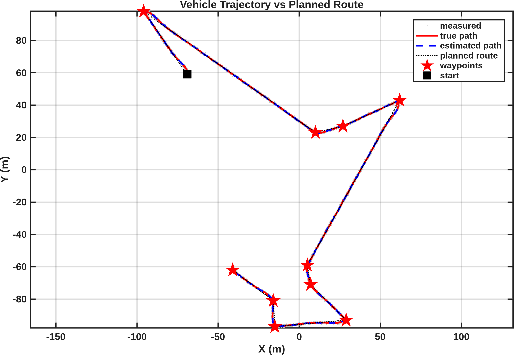
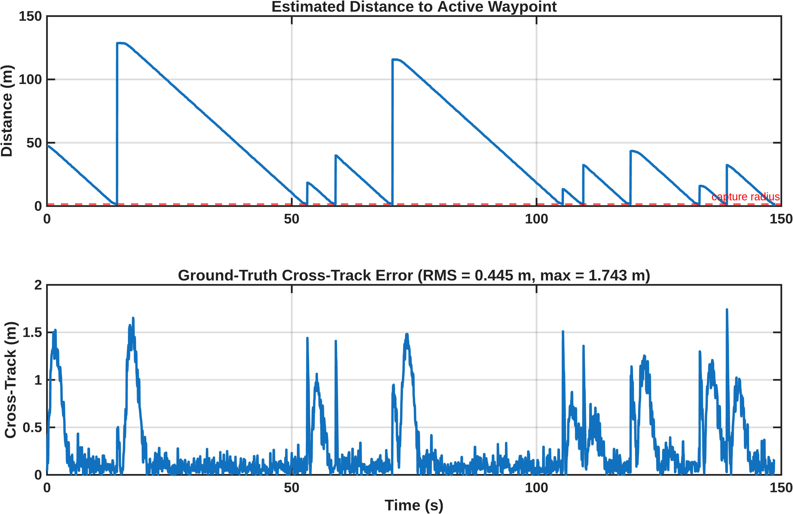
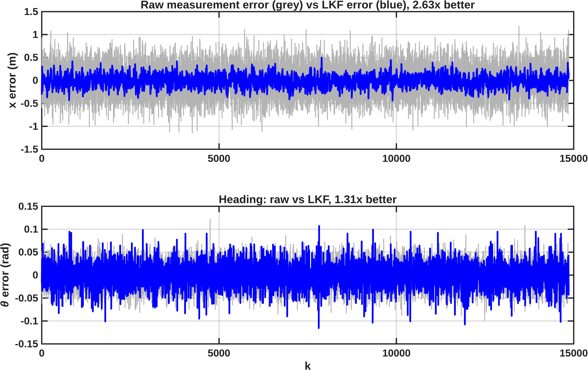
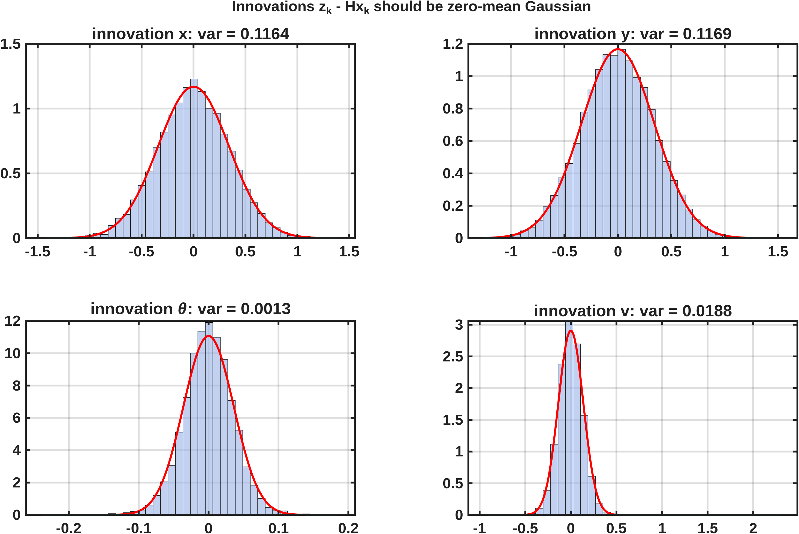

# EGH446 Major Project, Part A

**Waypoint optimisation, guidance, control and state estimation for an autonomous ground robot.**

MATLAB/Simulink project for EGH446 Autonomous Systems (QUT, Semester 2 2026), Group 50.
An Ackermann-steered ground robot starts at a random pose and visits ten randomly generated
waypoints in `x, y ∈ [-100, 100] m`, in an optimised order, using only noisy pose
measurements (variance 0.1 m² in position, 2 deg² in heading).

Part B, which adds path planning and obstacle avoidance on top of this system, is in
[EGH446-MATLAB-B](https://github.com/chabodmasere/EGH446-MATLAB-B).



## How it works

| Subsystem | Method | Where |
| --- | --- | --- |
| Waypoint generation | Distinct random integer waypoints, excluding the start pose | `wp_gen.m` |
| Waypoint ordering | Ant colony optimisation with Bayesian-tuned parameters | `wp_antColony.m`, `aco_defaults.m` |
| Guidance | Receding virtual waypoint (RVWP) along each path segment, with in-order waypoint capture | `Guidance` block |
| Control | Proportional heading controller on the wrapped heading error, with distance-based speed | `Controller` block, `controller_params.m` |
| State estimation | Linear Kalman filter on a 7-state constant-velocity model | `State Estimation and Filtering` block |
| Analysis | Post-run GNC and estimator figures, saved automatically | `mission_analysis.m` |

The guidance, controller and estimator code lives inside the Simulink model
`sl_groundvehicleDynamics.slx`. The controller only ever sees the filtered estimate;
the true pose is used for offline evaluation only.

### Waypoint ordering

`mdl_robot.m` generates a new mission each run: a random start pose, ten waypoints, and the
visiting order from `wp_antColony`. The ACO parameters come from `aco_defaults.m`, which holds
three sets:

| Set | Tuned for | Held-out result |
| --- | --- | --- |
| `N10` (active) | 10 waypoints | 97.7% optimal tours, 0.024% mean gap over 5000 trials |
| `N20` | 20 waypoints | 66.6% optimal tours, 0.27% mean gap |
| `original` | hand-picked starting point | 92.3% optimal tours, 0.096% mean gap at N = 10 |

The tuned sets came from Bayesian optimisation over all seven parameters, scored against exact solutions.

### Guidance and control

Guidance steers at a virtual point a fixed lookahead ahead of the vehicle's projection on the
current path segment, so the vehicle converges onto the line between waypoints instead of
just pointing at the next one. A waypoint is captured inside the capture radius and the
simulation stops itself after the last one.

| Parameter | Value |
| --- | --- |
| Heading gain `K_theta` | 1 |
| Speed gain `K_dist` | 0.75 |
| Speed limit `v_max` | 3.5 m/s |
| Yaw-rate limit `omega_max` | 2π/5 rad/s |
| RVWP lookahead | 5.0 m |
| Capture radius | 1.5 m |



### State estimation

A linear Kalman filter is used rather than an EKF: pose is measured directly, and the motion
model is linear when position is written as the integral of Cartesian velocity. The state is
`[px, py, θ, v, ω, vx, vy]`, the measurement is `[x, y, θ, v]`, and the process noise uses the
exact discretisation of the continuous model. Process noise was tuned by innovation consistency.





## Example run

From the mission shown in the figures above:

- all ten waypoints captured in about 150 s
- ground-truth cross-track error of 0.445 m RMS, 1.74 m maximum (at the turns after each capture)
- position error 2.63 times smaller than the raw measurement, heading error 1.31 times smaller

## Running it

Requires MATLAB R2025b or later with Simulink. The Mobile Robotics Simulation Toolbox ships
inside `toolboxes/MRTB` and is started for you. R2024b and R2023b copies of the model sit alongside the main one.

```matlab
cd sim_env
startupGround     % adds the toolboxes to the path and opens sl_groundvehicleDynamics
```

Then press **Run** in Simulink. When the run finishes, `mission_analysis` is called from the
model's `StopFcn`: it opens the main plots as tabs in one window and saves every figure as a
300 DPI PNG into `sim_env/images/`. `sim_env/Manual.mlx` is the operating manual and explains
how to read the printed summary.

```matlab
mission_analysis(Save=false)      % show the tabs only, save nothing
mission_analysis(Verbose=true)    % also print the raw P, K and innovation matrices
```

## Repository layout

```text
sim_env/
├── startupGround.m            entry point
├── Manual.mlx                 operating manual
├── controller_params.m        controller and guidance tuning
├── mission_analysis.m         post-run analysis, called automatically
├── controller_analysis.m      earlier standalone analysis script
├── images/                    figures written by mission_analysis
└── toolboxes/
    ├── ground_robot/          Simulink model, mission setup, waypoint generation and ACO
    └── MRTB/                  MathWorks Mobile Robotics Simulation Toolbox
```

## Authors

Chabod Masere, Jonah Menzies and Balin Carkeet (Group 50), Queensland University of Technology.

The simulation environment is provided by the EGH446 teaching team and builds on the
[Mobile Robotics Simulation Toolbox](https://github.com/mathworks-robotics/mobile-robotics-simulation-toolbox) (The MathWorks, Inc.).
